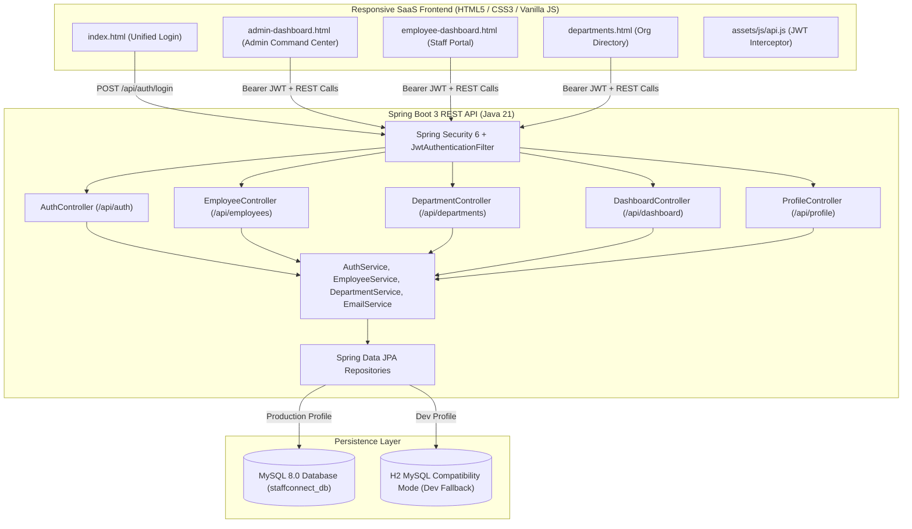

# StaffConnect: Enterprise Workforce Management Portal
> *Connecting People, Simplifying Workforce Management*

StaffConnect is a full-stack, enterprise-grade Employee Directory Management System built with **Spring Boot 3 (Java 21)**, **Spring Security 6 with JWT**, and a **vanilla HTML5/CSS3/JavaScript responsive SaaS frontend**. 

---

## 1. Technology Stack Compliance

| Layer | Technology | Specification / Details |
| :--- | :--- | :--- |
| **Backend Language** | Java | **Java 21 LTS** (Temurin / OpenJDK 21) |
| **Framework** | Spring Boot | **Spring Boot 3.3.0** with Spring Web & Bean Validation |
| **Security & Auth** | Spring Security | **Spring Security 6**, BCrypt (10 rounds), Stateless JWT (`jjwt 0.12.5`) |
| **Data & ORM** | Spring Data JPA | Hibernate 6.5, Declarative Repositories & JPQL |
| **Database** | MySQL / Dual Profile | **MySQL 8.0+** production driver + Zero-friction embedded Dev profile |
| **Build Tool** | Apache Maven | Maven Wrapper (`mvnw.cmd` / `mvnw`) bundled |
| **Email Service** | Spring Mail | **Gmail SMTP** (`JavaMailSender`) with resilient mock logging fallback |
| **Frontend** | Pure Web Standards | **HTML5, Modern CSS3 (CSS Variables, Flexbox, Grid), Vanilla JS ES6+** |
| **Data Viz** | Chart.js 4.4 | Doughnut & Bar charts for HR analytics |
| **Icons** | FontAwesome 6 | Enterprise SVG icon library |
| **IDE** | VS Code | Configured for Visual Studio Code & Java Extension Pack |

---

## 2. System Architecture



---

## 3. Key Features

### Authentication & Authorization
- **Unified Login**: Common corporate sign-in for Administrators and Employees.
- **Role-Based Routing**: 
  - `ROLE_ADMIN` &rarr; Automatically routed to **Admin Command Center** (`admin-dashboard.html`).
  - `ROLE_EMPLOYEE` &rarr; Automatically routed to **Staff Workspace** (`employee-dashboard.html`).
- **Security**: Passwords hashed with **BCrypt**, stateless **JWT tokens** (24-hour expiration) passed in `Authorization: Bearer <token>` headers.
- **Session Tracking**: Tracks exact `last_login` timestamp and displays it in the topbar.
- **Change Password**: Self-service password updates with current password verification.
- **No Public Registration**: Public sign-up is blocked; only Administrators can onboard employees.

### Admin Command Center
- **Executive KPIs**: Real-time counters for Total Workforce, Active Staff, On Leave, and Departments.
- **Interactive Analytics**:
  - Department Headcount Distribution (Doughnut Chart).
  - 6-Month Hiring Velocity Trends (Bar Chart).
- **Employee Directory Management (Full CRUD)**:
  - Rich data table with employee avatars, ID codes, departments, titles, roles, and status tags.
  - **Live Search**: Instant real-time filtering by name, email, employee ID, or designation.
  - **Multi-Facet Filters**: Filter by Department and Employment Status (`ACTIVE`, `ON_LEAVE`, `INACTIVE`).
  - **Add Employee**: Modal with automatic employee ID assignment (`EMP-100X`), auto-generated password, department selection, and welcome notification.
  - **Edit Employee**: Modal to update job designations, departments, compensation, location, and credentials.
  - **Status Toggle**: Quick one-click toggle between `ACTIVE`, `ON_LEAVE`, and `INACTIVE` (which automatically enables/disables login access).
  - **Employee Dossier**: Comprehensive profile drawer with tenure, work address, skills badges, and bio.
  - **Delete Employee**: Deletion confirmation with permanent removal of credentials and dossier.
  - **CSV Export**: One-click export of directory to `StaffConnect_Directory_YYYY-MM-DD.csv`.
- **Department Management**: Add/manage departments with budget, location, and department head tracking.
- **Audit Logging**: Tracks every creation, modification, status update, and login in `audit_logs`.

### Employee Self-Service Portal
- **Personal Hero Banner**: Displays employee avatar, name, ID code, job title, department, years/months of service (tenure), and department head.
- **Department Teammates**: Quick contact grid showing colleagues in the same department with one-click `mailto:` and `tel:` links.
- **Company Directory**: Read-only directory search across all organization colleagues.
- **My Profile Management**: Ability to update phone number, office location, professional bio, technical skills, and avatar URL.
- **Account Security**: Secure password update form.

---

## 4. Default Demo Accounts

The login page includes **Quick-Fill Demo buttons** for instantaneous evaluation:

| Role | Email | Password | Pre-seeded Profile |
| :--- | :--- | :--- | :--- |
| **Administrator** | `admin@staffconnect.com` | `Admin@123` | Alex Morgan (Chief Technology Officer) |
| **Employee** | `sarah.chen@staffconnect.com` | `Staff@123` | Sarah Chen (Senior Backend Engineer) |
| **Employee** | `marcus.johnson@staffconnect.com` | `Staff@123` | Marcus Johnson (People Operations Lead) |
| **Employee** | `elena.rostova@staffconnect.com` | `Staff@123` | Elena Rostova (Lead UI/UX Designer) |
| **Employee** | `david.kim@staffconnect.com` | `Staff@123` | David Kim (Growth Marketing Director) |
| **Employee** | `priya.patel@staffconnect.com` | `Staff@123` | Priya Patel (Senior Financial Analyst) |

---

## 5. Getting Started & Running the Project

### Prerequisites
- **Java 21 JDK** installed (`java -version`).
- Apache Maven (bundled via `./mvnw.cmd` or standalone).
- MySQL 8.0+ (optional: app defaults to zero-setup embedded mode if MySQL is not running).

### Option A: Quick One-Click Launch (Windows)
Double-click `start-all.bat` in the project root:
```cmd
start-all.bat
```
This automatically starts the Spring Boot backend on port 8080 and opens `frontend/index.html` in your default browser.

---

### Option B: Running Backend & Frontend Separately

#### 1. Start the Backend
Navigate to the `backend` folder:
```cmd
cd backend
.\mvnw.cmd spring-boot:run
```
The backend starts at `http://localhost:8080`.
- API Base URL: `http://localhost:8080/api`
- H2 Console: `http://localhost:8080/h2-console` (JDBC URL: `jdbc:h2:mem:staffconnect_db`, User: `sa`, Password: empty)

#### 2. Open the Frontend
You can open `frontend/index.html` directly in any modern browser, or serve it using VS Code Live Server / Python:
```cmd
cd frontend
start index.html
```
Or using Python:
```cmd
python -m http.server 3000
```
Open `http://localhost:3000` in your browser.

---

### Option C: Running with MySQL

1. Make sure MySQL Server is running on port `3306`.
2. Run the database script:
   ```cmd
   cd database
   setup_mysql.bat
   ```
   Or manually in MySQL CLI:
   ```sql
   source database/schema.sql;
   source database/sample-data.sql;
   ```
3. Start the backend with the `mysql` profile:
   ```cmd
   cd backend
   .\mvnw.cmd spring-boot:run -Dspring-boot.run.profiles=mysql
   ```

---

## 6. Email Configuration (Gmail SMTP)

Email dispatch is managed by `EmailService.java`.
- **Default Mode (`mail.enabled=false`)**: Simulated mode. Welcome credentials are printed in high-fidelity formatting to the Spring Boot server console so no email credentials are required for hackathon judging.
- **To enable real Gmail SMTP**:
  1. Open `backend/src/main/resources/application.properties`.
  2. Set:
     ```properties
     spring.mail.username=your-gmail@gmail.com
     spring.mail.password=your-16-character-app-password
     mail.enabled=true
     ```

---

## 7. REST API Reference

### Authentication (`/api/auth`)
| Method | Endpoint | Access | Description |
| :--- | :--- | :--- | :--- |
| `POST` | `/api/auth/login` | Public | Authenticate user, update last login, return JWT |
| `POST` | `/api/auth/change-password` | Authenticated | Change user password |
| `GET` | `/api/auth/me` | Authenticated | Get current authenticated user details |

### Employee Management (`/api/employees`)
| Method | Endpoint | Access | Description |
| :--- | :--- | :--- | :--- |
| `GET` | `/api/employees` | Authenticated | Search & filter employee directory |
| `GET` | `/api/employees/{id}` | Authenticated | Get employee dossier by ID |
| `POST` | `/api/employees` | `ROLE_ADMIN` | Register new employee & create user credentials |
| `PUT` | `/api/employees/{id}` | `ROLE_ADMIN` | Update employee information |
| `PATCH` | `/api/employees/{id}/status` | `ROLE_ADMIN` | Toggle status (`ACTIVE`/`ON_LEAVE`/`INACTIVE`) |
| `DELETE` | `/api/employees/{id}` | `ROLE_ADMIN` | Delete employee & user record |

### Employee Self-Service (`/api/profile`)
| Method | Endpoint | Access | Description |
| :--- | :--- | :--- | :--- |
| `GET` | `/api/profile` | Authenticated | Get logged-in employee profile |
| `PUT` | `/api/profile` | Authenticated | Update personal phone, address, bio, skills, avatar |

### Departments (`/api/departments`)
| Method | Endpoint | Access | Description |
| :--- | :--- | :--- | :--- |
| `GET` | `/api/departments` | Authenticated | List all departments with headcount |
| `POST` | `/api/departments` | `ROLE_ADMIN` | Create new department |
| `PUT` | `/api/departments/{id}` | `ROLE_ADMIN` | Update department details |
| `DELETE` | `/api/departments/{id}` | `ROLE_ADMIN` | Remove department (checks employee count) |

### Analytics Dashboard (`/api/dashboard`)
| Method | Endpoint | Access | Description |
| :--- | :--- | :--- | :--- |
| `GET` | `/api/dashboard/stats` | `ROLE_ADMIN` | Get KPI metrics, charts data, and audit logs |
| `GET` | `/api/dashboard/employee` | Authenticated | Get teammate cards and personal workspace data |
